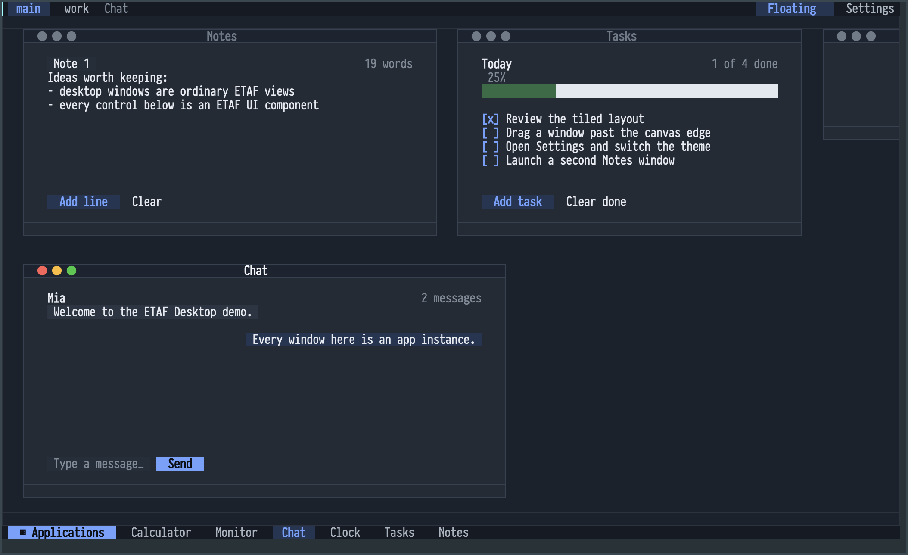

# ETAF Desktop

ETAF Desktop is an application-level desktop manager built on ETAF and ETAF UI.
It owns windows, workspaces, focus order, z-order, geometry policy and the
normal/minimized/maximized lifecycle. Ebox remains the retained layout and
incremental publication provider; ETAF UI's `etaf-window` is the controlled
presentation shell.

The demo desktop at a wide frame:



## Minimal example

```elisp
(add-to-list 'load-path "/path/to/etaf")
(add-to-list 'load-path "/path/to/etaf-ui")
(add-to-list 'load-path "/path/to/etaf-desktop")
(require 'etaf-desktop)
(let ((desktop (etaf-desktop-open)))
  (etaf-desktop-open-window desktop 'notes
    :title "Notes" :view (etaf-view (text "Hello"))))
```

Use the public mutation functions to move, resize, focus, maximize, minimize,
restore and close windows. See [the manual](docs/manual.md) for the complete
contract and [architecture](docs/architecture.md) for ownership boundaries.

## Runnable demo

`M-x etaf-desktop-demo-open` mounts a complete desktop with six sample
applications (Notes, Tasks, Clock, Calculator, Chat and Monitor) spread over
two workspaces. From a checkout with sibling providers:

```sh
cd etaf-desktop
emacs -Q -L ../ecss -L ../ebox -L ../etaf -L ../etaf-ui -L . \
  -l etaf-desktop -f etaf-desktop-demo-open
```

The source is [examples/etaf-desktop-demo.el](examples/etaf-desktop-demo.el);
each application is a compact model of the `etaf-desktop-register-app`
contract described in [the manual](docs/manual.md#applications-and-instances).

## Checks

Run `make check` with Emacs 29.1 or newer and sibling `etaf`, `etaf-ui`, `ebox`
and `ecss` checkouts.

The workspace's `scripts/performance.py` includes native mouse workloads named
`etaf-desktop.demo.*`. They run the complete six-application demo with its Clock
timer, covering Notes launch/close, Settings open/close and all four tabs, and
Notes/Tasks content focus. Every sample checks lifecycle, active window and the
unchanged geometry of existing windows. Launch/close samples use fresh demos;
shell and focus samples retain their demo within a set. These workloads reopen
the demo through its public entry, which closes any previous demo controller.
Run them against your normal configured Emacs server, for example from the
workspace root:

```sh
python3 scripts/performance.py run --mode gui \
  --scenario 'etaf-desktop.demo.settings-*' --scenario etaf-desktop.demo.focus \
  --sets 1 --samples 3 --diagnose
```

This is a diagnostic screen; the workspace performance manual describes the
three-set acceptance protocol and its 10 ms interaction budget. Native input is
prequeued and does not certify physical pointer-to-display latency.
